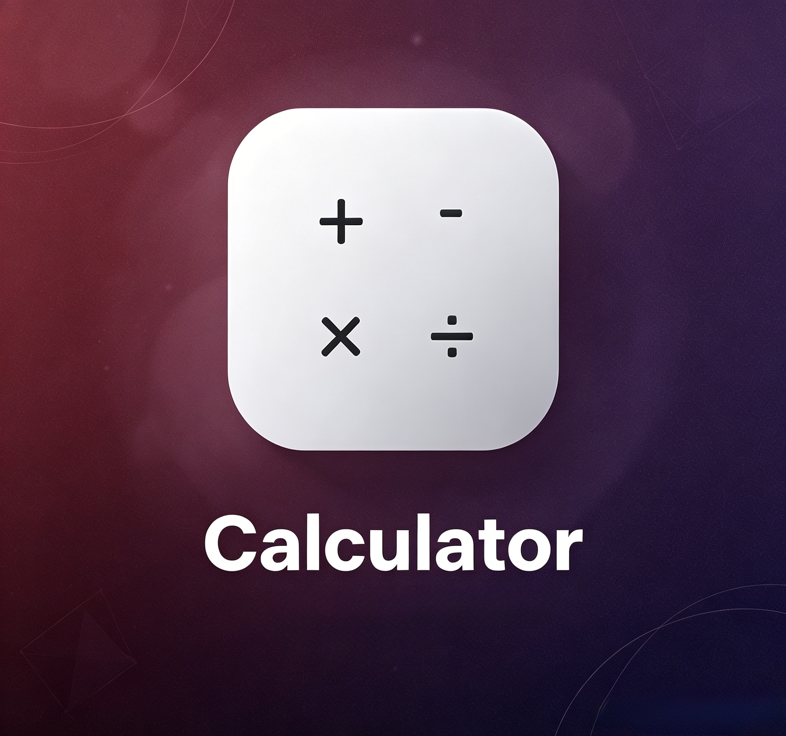
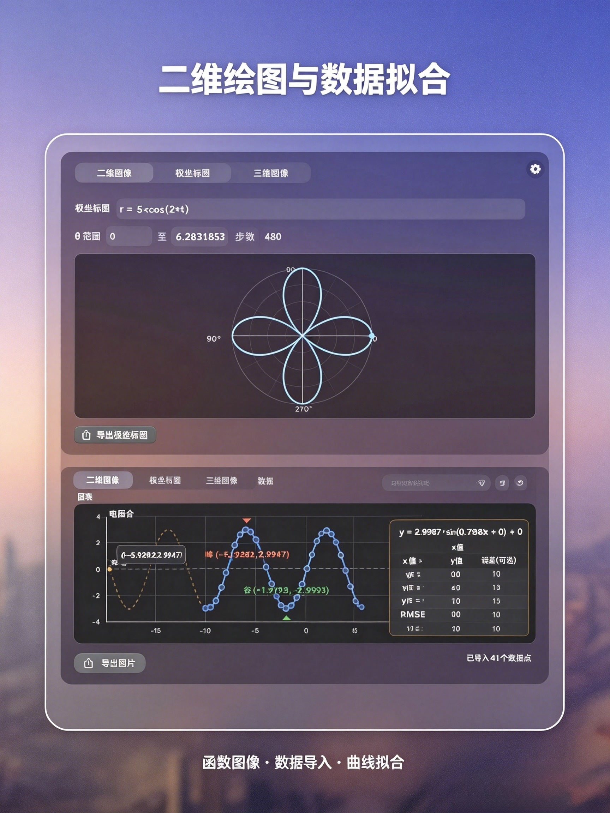
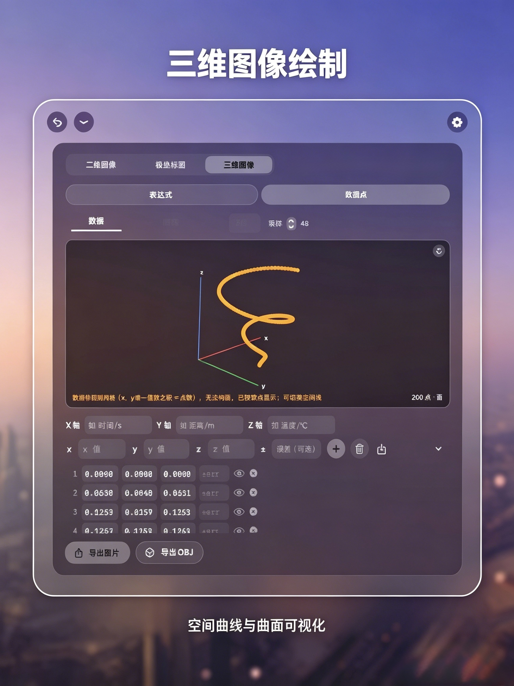

---
AIGC:
    Label: "1"
    ContentProducer: 001191440300708461136T1XGW3
    ProduceID: 834947731de00f8150b35d33817278ca_7ffc8f38c7d711f1b5a6525400393706
    ReservedCode1: YUlbSlw5ZMfPS9ZKrcgoqGopumc0cBmLsimwwLdeEOMqregs+SPyq7qgDnkhp7l79VY+/bnFwNasrumhaLgr/pN7/xfzCgoVMaWgDoWZtjYU0wMRRtovB/3lOCkZygBjK6k59CYB2TGTp1Mi2AF9+zB16YBxwzTdk3e6IpSgApeYkvsw+Z9+bPU5ayo=
    ContentPropagator: 001191440300708461136T1XGW3
    PropagateID: 834947731de00f8150b35d33817278ca_7ffc8f38c7d711f1b5a6525400393706
    ReservedCode2: YUlbSlw5ZMfPS9ZKrcgoqGopumc0cBmLsimwwLdeEOMqregs+SPyq7qgDnkhp7l79VY+/bnFwNasrumhaLgr/pN7/xfzCgoVMaWgDoWZtjYU0wMRRtovB/3lOCkZygBjK6k59CYB2TGTp1Mi2AF9+zB16YBxwzTdk3e6IpSgApeYkvsw+Z9+bPU5ayo=
---

# 计算器（Calculator）

<p align="center">
  <a href="#中文文档"><b>中文</b></a> ·
  <a href="#english-documentation"><b>English</b></a>
</p>

<p align="center">
  
  
  
  
  
  
</p>

<a id="中文文档"></a>

## 中文文档

计算器是一款 macOS 桌面计算器应用，基于 SwiftUI + AppKit 开发。它把日常计算、汇率换算、单位换算、进制转换、实验数据绘图（二维 / 极坐标 / 三维）与番茄钟收进一个「圆盘 + 计算窗口」的两级悬浮界面，所有计算都在本地完成，仅在汇率换算与检查更新时访问网络。

> 本项目由 **f8r4ksv7v4-hub** 原创开发与维护，界面与全部功能均为原创实现。仓库仅提供说明文档与官方安装包，不提供源码。

- **English documentation**: [English Documentation](#english-documentation)

### 界面预览

<p align="center">
  
</p>

<table align="center">
  <tr>
    <td align="center"><br><sub>圆盘主菜单</sub></td>
    <td align="center"><br><sub>科学计算与汇率换算</sub></td>
    <td align="center"><br><sub>番茄钟与进制转换</sub></td>
  </tr>
  <tr>
    <td align="center"><br><sub>极坐标绘图与数据拟合</sub></td>
    <td align="center"><br><sub>三维空间螺旋曲线</sub></td>
    <td align="center"></td>
  </tr>
</table>

### 计算式绘图（3.x 主打功能）

2.x 的绘图是「录点 → 画线」。3.x 把它升级为一台**实验数据处理工作站**：数据表是唯一数据源，图线是它的视图，公式是两者之间的桥。

**一张表装下整个实验**
- 全局数据表，可建多张并随时切换（一张表一个实验、一组样品或一次测量）。
- 行列任意增删，表头自定义且**表头就是公式变量**：`[电压] / [电流]` 直接算出电阻，不用记 A1、B2；中文、空格、下标都能当列名（`[温度 T]`、`[第 1 组]`）。
- 新建表只给一行空白，填满末行自动追加下一行；导入 CSV / TSV / TXT / Excel 后自动补空白行，边看数据边追录。

**计算列：写一条公式，整列同时算出**

| 写法 | 能做什么 |
| --- | --- |
| `[电压] / [电流]` | 逐行四则运算，列与列直接算 |
| `[时间]^2` | 先构造 t² 列，再做线性拟合 |
| `ln([浓度])` | 一级反应动力学线性化 |
| `sqrt([面积] / pi)` | 反推半径（常量 `pi` / `π` / `e` 可直接用） |
| `mean([读数])` | 整列均值，自动铺到每一行，可直接画均值线 |
| `([读数] - mean([读数])) / std([读数])` | 一条公式做 z-score 标准化 |
| `if([温度] > 25, 1, 0)` | 按阈值条件分组打标签 |
| `pow([r], 3) * 4 / 3 * pi` | 多参数函数与幂运算自由组合 |

- **运算符**：`+ - * / ^`、一元正负、比较 `> < >= <= == !=`
- **函数**：`abs sqrt cbrt round floor ceil sign exp ln log log10 log2`，三角与反三角 `sin cos tan asin acos atan sec csc cot`，双曲 `sinh cosh tanh`
- **多参数**：`pow(a,b)`、`mod(a,b)`、`atan2(y,x)`、`if(条件, 真值, 假值)`
- **整列聚合**：`mean / avg / sum / min / max / count / median / std / stdp / first / last / range`
- 面板内置**符号速查表**与「插入函数」菜单，不用背语法

**工程化的细节**
- 计算列可引用另一条计算列，引擎按依赖关系自动拓扑排序求解；互相引用会明确标记「循环引用」。
- 逐列缓存按内容签名失效，只重算受影响的那一列，几千行也能边改边刷。
- 公式写错、除数为 0、依赖列出错，原因直接标在对应列旁；除零单元格留空而不是塞 `inf`。
- 重命名列时公式引用自动同步，不会断链。
- 三角函数按弧度计算，界面直接提示「角度需先乘 π/180」。

**图线是表的视图**
- 图线可绑定表的 **x / y / z / 误差**列：改一个单元格，曲线立刻重画；绑定 z 列可直接用于三维绘图。
- 需要冻结某份数据时点**固化**：当前点集固化为独立图线，之后改表也不影响它；也可解除绑定或删除。
- 预览区「清空图线」一键清掉所有线（含绑定派生线、已固化线与删表后的残留线）并断开绑定。
- 导出把公式结果一并带走：CSV（多线分列 + 逐线拟合汇总）、Excel xlsx、三维 OBJ、PNG（屏幕所见即导出所见）。

### 版本说明

| 版本 | 圆盘项数 | 主要差异 |
| --- | --- | --- |
| **3.3.3**（当前版本） | 13 | 位置记忆修复：① **拖到右半边记不住** —— 原生 `performDrag` 在非激活面板 / 后台应用状态下会提前返回，松手瞬间读到的 `frame.origin` 还是拖拽前的旧值，位置记忆于是永远慢一步；现在改为等鼠标真正抬起、窗口落位后再取最终 frame 落盘；② **钳制放宽** —— 旧逻辑要求整窗都落在可见区内，1280pt 屏上 700pt 宽的矩阵窗最右只能到 x=572（正好屏幕正中），拖到右半边一重开就被拉回中间；现在只保证横向至少 160pt 可见、顶栏拖拽条抓得到，顶边不进菜单栏，宽窗口也能稳定停在右半边 |
| 3.3.2 | 13 | ① **设置面板三次重做** —— 弃用 `.sheet`（会反复弹出、关不掉），改为单例系统标题栏窗口，Esc 关闭、⌘, 唤起，菜单展开前重绑快捷键，保证唯一窗口不回弹；② **设置窗置顶** —— 窗口层级提到 `statusBar + 2`，不再被计算器主面板遮挡（此前层级代码误写进常驻隐形窗口，被后续 `.normal` 覆盖）；③ **主题跟随系统立即生效** —— 选中「跟随系统」后显式同步 `NSApp.appearance` 与各窗口 appearance，白天选深色再切回跟随系统能立刻变回浅色；④ **退回圆盘动画重做** —— 方形窗口朝自身中心收起淡出，圆盘随即从屏幕正中展开，不再有「先滑回中间」的过渡 |
| 3.3.1 | 13 | 3.3.0 的手感补丁，全部围绕「窗口动效」：① **拖拽改原生接管** —— 旧实现用 `DragGesture` 做窗口拖动，在 macOS 窗口坐标系下会产生累积漂移（越拖越偏），改为 `NSViewRepresentable` 包一个拖拽区直接调 `NSWindow.performDrag(with:)`；② **退回圆盘不再卡顿** —— 窗口位移改由 `NSView.displayLink` 对齐屏幕刷新逐帧驱动（原来用 60 Hz `Timer`，与 120 Hz 屏不同步、帧间隔抖动），且回圆盘时只滑动位置、不逐帧改窗口尺寸，配合内容纯淡出，滑动与收缩同帧对齐；③ 番茄钟窗口顶栏中部同样改为原生拖拽并记忆位置 |
| 3.3.0 | 13 | 一次以体验为主的改版：① **设置面板重做** —— 改为与「历史记录」侧栏同源的无边框圆角毛玻璃窗口，自绘分区卡片、悬停高亮行与胶囊开关，标题栏可拖动移动；② **登录时启动** —— 首选 `SMAppService` 系统登录项，注册失败（应用不在「应用程序」文件夹、未公证等）自动改用 `~/Library/LaunchAgents` 用户级启动项，因此在任何 Mac 的任何目录下都能生效，关闭时 bootout + 删除 plist 不留残余；③ **窗口可拖动** —— 第二级计算窗口与番茄钟窗口的顶栏中部整块空白即拖拽区，位置会被记住（换显示器或改分辨率自动回落居中），圆盘作为主入口强制居中、不记忆位置 |
| 3.2.6 | 13 | 相对 2.0 累积三组大改：① **计算式绘图（本轮主打）**——绘图页从「录点画线」升级为实验数据处理工作站：全局**数据表**（多表切换、行列增删、自定义表头**直接作为公式变量**、填满末行自动补行、CSV / Excel 导入）、**计算列**（列引用 `[列名]`、`^` 幂与比较、`ln / log / sqrt / if / pow / mod / atan2` 等函数、整列聚合 `mean / sum / std / stdp / median / range` 等，一条公式算出整列，聚合自动铺满每一行）、**图线绑定表列实时联动**（x / y / z / 误差，可固化 / 解除 / 删除），并具备依赖拓扑排序、循环引用检测、逐列缓存、列重命名自动同步公式等工程化内核；② 新增**矩阵计算**模式（圆盘第 13 项，矩阵 A / B / 结果三级页：加减乘、数乘、转置、行列式、逆、秩、解 Ax=b，运算式只在结果页）；③ **按钮布局与逻辑关系重做**：控件按四级视觉层级分规格、危险操作统一红系语义色并收敛到单一二次确认弹窗；另含绘图页双模式拆分与「清空图线」兜底、科学模式**整式输入**（按 `=` 一次性求值，支持括号 / 优先级 / 隐式乘法 / 函数 / π / e / `^` / `%` / ±）、图线重建延后到停止输入、**i 使用说明面板**扩写为双语逐按钮说明 |
| 2.3 | 12 | 在 2.0 之上新增：绘图的**多图线**（同一张图内多条曲线，逐线数据 / 颜色 / 拟合）、**导出 CSV**（多线分列并汇总逐线拟合结果）、三维**导出 OBJ**，以及各二级窗口右上角的 **i 使用说明** 面板 |
| 2.0 | 12 | 在 1.0 全部功能之上新增「番茄钟」：独立窗口、左下角剩余时间胶囊、到时提醒 |
| 1.0 | 11 | 普通 / 科学 / 汇率 / 重量 / 温度 / 面积 / 速度 / 时间 / 存储 / 进制 / 绘图 |

> 说明：**3.3.3 已发布**，[Releases](https://github.com/f8r4ksv7v4-hub/Calculator/releases) 页面上最新安装包为 **3.3.3**（资产名 `Calculator-3.3.3-macOS.zip`），另有 **3.2.6**、**2.0** 与 **1.0**。应用内的「检查更新」只会下载 Release 中名称含 `macOS` 的 zip 资产。全版本零第三方依赖，仅使用系统框架（SwiftUI / AppKit / ServiceManagement / QuartzCore / Compression）。

### 功能特性

- **圆盘两级交互**：第一级为悬浮圆盘（2.0 起为 12 项，3.2.6 起新增「矩阵」共 13 项，圆盘半径自适应），第二级为计算窗口；圆盘中心按钮可让圆盘收缩消失并隐藏窗口
- **普通计算**：四则运算、百分号、多层括号嵌套
- **科学计算**：sin / cos / tan、log、ln、√、x²、x!、π、e，角度与弧度可切换
- **汇率换算**：以人民币为基准在线获取实时汇率，离线时使用本地缓存
- **单位换算**：重量、温度、面积、速度、时间、存储六类
- **进制转换**：二进制 / 八进制 / 十进制 / 十六进制，输入即时换算
- **矩阵计算（3.2.6）**：矩阵 A / B 网格编辑（行数列数可调、一键填单位阵），支持 A±B、A×B、k·A、转置、行列式、逆、秩与解 Ax=b；输入页保持纯净，运算式只出现在结果页，结果可复制
- **实验数据绘图**：
  - 二维图像：手动录入或表格导入数据点，折线 / 光滑曲线，线性、二次、三次、四次、五次、指数、对数、幂律、正弦等拟合并给出 R² / RMSE；支持数据变换（ln x、ln y、log10 x、log10 y、1/x、1/y、y 归一化）、对数轴、范围锁定、平滑强度、双游标、切线、误差棒、波峰 / 波谷标注、均值线、面积、坐标标签、自定义图表标题与坐标轴名称单位
  - 极坐标图：输入关于角度 t 的半径表达式，设定角度范围与采样数，附带同心圆网格、角度线与角度标签
  - 三维图像：表达式曲面 z = f(x, y) 或三维数据点（曲面网格 / 空间线）；拖动旋转、缩放；拟合平面、外推、切平面、两点测量；x / y / z 轴名称、点坐标标签、均值面、误差棒、范围锁定
  - **多图线（2.3）**：同一张图内可添加多条图线，逐线独立的数据、颜色、显示与拟合配置，图例与逐线拟合结果一并绘制与导出
  - **计算式绘图（3.x，主打）**：绘图页分为「直接绘图 / 计算式绘图」两种模式，后者是一套完整的实验数据处理流程——建表、写公式、画线，三者共用一份数据：
    - **全局数据表**：可建多张表并切换（一表一实验），任意增删行列，自定义表头**直接当公式变量**（`[电压]`、`[温度 T]` 皆可，支持中文与空格）；新建表只给一行空白，填满末行自动续行；支持 CSV / TSV / TXT / Excel 导入
    - **计算列**：一条公式算出整列，支持 `+ - * / ^` 与比较运算，`abs sqrt ln log log10 exp round floor ceil` 等数学函数，`sin cos tan asin acos atan` 等三角反三角（弧度），多参数 `pow / mod / atan2 / if(条件, 真值, 假值)`，以及整列聚合 `mean / sum / min / max / count / median / std / stdp / first / last / range`（聚合结果自动铺到每一行，可直接画均值线）
    - **工程化内核**：计算列可互相引用并自动拓扑排序求解，循环引用明确标记；逐列缓存按内容签名失效，只重算受影响的列；公式错误、除零、依赖出错均在列旁标注原因，除零单元格留空；重命名列自动同步所有公式引用
    - **图线绑定与联动**：图线可绑定表的 x / y / z / 误差列，改表即改图；支持固化为独立图线、解除绑定、删除；「清空图线」一键清掉绑定派生线与删表残留线
    - 面板内置公式符号速查表与插入函数菜单，绘图历史可恢复当时的数据表、公式与绑定
  - 曲线数字化（从图片提取数据点）、绘图历史（可恢复数据与设置重新生成）
  - 导出 PNG（屏幕所见即导出所见）、导出 CSV（数据点与拟合结果）、三维导出 OBJ
- **番茄钟（2.0）**：工作 / 休息时长可自定义（默认 25 / 5 分钟自动循环）；工作结束与休息结束的提醒方式各自独立配置（静音 / 震动 / 响铃 / 响铃 + 震动，响铃与震动强度可调），到时有屏幕边缘光晕呼吸提示；收起后左下角小角常驻显示剩余时间胶囊，可直接开始 / 暂停
- **使用说明面板（2.3）**：各二级窗口右上角的 **i** 按钮可打开中英双语使用说明，覆盖圆盘交互、快捷键、二维 / 极坐标 / 三维绘图、多图线、番茄钟、自动更新与设置
- **历史记录**：普通与科学模式保留最近 20 条计算历史，重启后仍在
- **中英双语**：界面一键切换中文 / English，即时生效
- **外观与触发**：跟随系统深浅色或手动固定；可隐藏 Dock 图标，仅保留屏幕左下角触发展开
- **窗口拖拽与位置记忆（3.3.0）**：第二级计算窗口与番茄钟窗口可在顶栏中部直接拖动，松手即记住位置，下次打开沿用（记忆点不在任何屏幕内时自动回落居中）；圆盘作为主入口始终居中
- **设置面板（3.3.0 重做）**：无边框圆角毛玻璃窗口，「语言 / 通用 / 外观 / 关于」四区分组卡片，行悬停高亮、胶囊开关，标题栏可拖动
- **登录时启动（3.3.0）**：优先生成系统登录项（可在「系统设置 › 通用 › 登录项」管理）；应用不在「应用程序」文件夹、签名不受信任等情况下自动改用用户级启动项，任何 Mac 上都能开机自启；需系统批准时设置页给出直达入口，失败原因直接显示在开关下方
- **窗口动效（3.3.1）**：圆盘 ↔ 计算窗口的位移与缩小由显示刷新逐帧驱动，内容淡出与窗口滑动同帧对齐，收起 / 返回全程不掉帧
- **窗口位置记忆（3.3.3）**：把计算窗口 / 番茄钟窗口拖到屏幕右半边后位置真正记住了 —— 改为窗口落位后再取最终 frame 落盘（此前原生拖拽在面板非激活时提前返回，存下的是拖拽前旧原点），同时钳制放宽到只需 160pt 可见，宽窗口不再被拉回正中
- **自动更新**：基于 GitHub Releases 自动检查、下载并原位安装新版本

### 环境要求

- macOS 15.7 或更高版本
- Apple Silicon（arm64）Mac
- 安装包约 4 MB，全部基于系统框架（SwiftUI / AppKit / ServiceManagement / QuartzCore / Compression），无任何第三方依赖

### 下载

| 版本 | 安装包 | 大小 | 下载直链 |
| --- | --- | --- | --- |
| **3.3.3**（推荐） | `Calculator-3.3.3-macOS.zip` | 约 3.7 MB | [下载](https://github.com/f8r4ksv7v4-hub/Calculator/releases/download/v3.3.3/Calculator-3.3.3-macOS.zip) |
| 3.2.6 | `Calculator-3.2.6-macOS.zip` | 约 3.6 MB | [下载](https://github.com/f8r4ksv7v4-hub/Calculator/releases/download/v3.2.6/Calculator-3.2.6-macOS.zip) |
| 2.0 | `Calculator-2.0-macOS.zip` | 约 2.0 MB | [下载](https://github.com/f8r4ksv7v4-hub/Calculator/releases/download/v2.0/Calculator-2.0-macOS.zip) |
| 1.0 | `Calculator-1.0-macOS.zip` | 约 1.9 MB | [下载](https://github.com/f8r4ksv7v4-hub/Calculator/releases/download/v1.0/Calculator-1.0-macOS.zip) |

> 3.3.3 为当前最新版本（含设置面板重做、主题跟随系统、窗口位置记忆修复）。

全部版本与更新日志见 [Releases](https://github.com/f8r4ksv7v4-hub/Calculator/releases) 页面。

### 安装与首次启动

1. 打开本仓库的 [Releases](https://github.com/f8r4ksv7v4-hub/Calculator/releases) 页面，下载对应版本的安装包（当前推荐 `Calculator-3.3.3-macOS.zip`，历史版本 `Calculator-3.2.6-macOS.zip` / `Calculator-2.0-macOS.zip` / `Calculator-1.0-macOS.zip`）
2. 双击解压得到「计算器.app」，拖入「应用程序」文件夹
3. **首次启动会被 Gatekeeper 拦截**：安装包为开发者签名、未经 Apple 公证，系统会提示「无法验证开发者」或「Apple 无法检查其是否包含恶意软件」。按以下任一方式放行即可：
   - 在「访达」中 **按住 Control 点击（或右键）**「计算器.app」→ 选择「打开」→ 在弹窗中再次点击「打开」
   - 若仍被阻止：打开 **系统设置 → 隐私与安全性**，在「安全性」一栏中点击 **「仍要打开」**，然后重新打开应用
   - 若上述方式仍无效，打开「终端」执行以下命令后再启动（移除下载隔离标记）：
     ```bash
     xattr -dr com.apple.quarantine /Applications/计算器.app
     ```
4. 首次运行会请求网络访问权限（用于获取汇率与检查更新），允许即可；拒绝不影响计算与绘图功能

### 使用方法

#### 第一级：圆盘

启动应用后显示第一级悬浮圆盘，圆盘上按顺时针依次排列各功能模式（3.2.6 起依次为：普通、科学、汇率、重量、温度、面积、速度、时间、存储、进制、绘图、矩阵、番茄钟）。

- 点击任意模式图标 → 圆盘收缩，进入第二级对应页面
- 点击圆盘中心按钮 → 圆盘向中心收缩消失，并隐藏窗口
- 圆盘始终位于屏幕正中，不跟随拖动（3.3.0 起）

#### 第二级：计算窗口

- 拖动窗口：按住顶栏中部的整块空白处拖动即可（3.3.0 起），松手后位置会被记住，下次展开沿用；圆盘本身不可拖动，始终居中
- 顶部左侧「返回」→ 回到第一级圆盘
- 顶部右侧分别为「收起」与「设置」；2.3 起「设置」左侧另有 **i** 使用说明入口
- 点击「收起」（或按 ⌘W / ↓）→ 窗口缩为屏幕左下角的小角
- 恢复窗口：把鼠标移到**屏幕最左下角**停留片刻露出小角，点击即可展开

#### 绘图

1. 圆盘选择「绘图」，窗口会自动加宽
2. 顶部切换「二维图像 / 极坐标图 / 三维图像」
3. 二维与三维在「数据 / 图表 / 工具」功能区中录入数据（手动添加或导入表格）、设置图表样式与拟合、显示元素与标注
4. 极坐标图输入半径表达式，并设定角度范围与采样数
5. 完成后可导出 PNG（二维另有 CSV，三维另有 OBJ）；导出记录进入绘图历史，可恢复数据与设置重新生成

**计算式绘图怎么用（3.x）**

1. 顶部模式切到「计算式绘图」，「数据」页即出现全局数据表
2. 改好表头（如 `x`、`电压`、`电流`），逐行录入或导入 CSV / Excel，末行填满会自动补下一行
3. 点「+ 计算列」，起个列名（如 `电阻`），写公式 `[电压] / [电流]`，整列立刻算出；需要标准化就写 `([电压] - mean([电压])) / std([电压])`，需要分组就写 `if([温度] > 25, 1, 0)`
4. 到「图线绑定」区把 x / y（三维再加 z）指向表列，曲线随表格实时重画；想要一份不再变化的数据就点「固化」
5. 到「图表」页选拟合类型，工具页设置标注与导出，CSV 会连计算列与逐线拟合结果一起导出

#### 番茄钟（2.0）

1. 圆盘选择「番茄钟」，打开独立窗口
2. 在窗口内设定工作 / 休息时长与到时提醒方式，点击开始即可计时
3. 点击「收起」→ 番茄钟窗口隐藏，左下角小角**常驻显示剩余时间胶囊**：胶囊上的按钮可直接开始 / 暂停，点击胶囊其它区域恢复番茄钟窗口
4. 点击「返回圆盘」→ 回到第一级圆盘

### 绘图功能按钮位置与功能

> 以下按「顶部切换 → 二维（数据 / 图表 / 工具）→ 极坐标 → 三维（数据 / 图表 / 工具）→ 多图线 → 导出 → 图像标定取点」逐项说明每个按钮、输入框与开关在界面中的位置与作用（对应 2.3 版界面）。

#### 顶部：绘图模式切换

| 位置 | 控件 | 作用 |
| --- | --- | --- |
| 绘图面板第一行左侧 | 三档分段控件「二维图像 / 极坐标图 / 三维图像」 | 切换绘图类型；切换后下方的功能区与图表整体替换 |
| 同一行右侧 | 灰色提示文字 | 提示当前模式可用能力：「支持拟合/外推/测量/切线/误差棒/对数轴/变换」（二维）、「用 t（或 θ）表示角度，支持 sin/cos/exp/sqrt 等」（极坐标）、「等距投影曲面；数据点可画面或空间线，可导出 PNG」（三维） |
| 第二行 | 页签「数据 / 图表 / 工具」（二维与三维） | 功能区分组标签，选中项以强调色加粗并带底部指示条 |

#### 二维图像 · 数据页

| 位置 | 控件 | 作用 |
| --- | --- | --- |
| 第一行 | 「横轴」+ 输入框（提示「如 时间/s」） | 设置 X 轴名称 / 单位，显示在坐标轴旁，导出 PNG 同样使用 |
| 第一行 | 「纵轴」+ 输入框（提示「如 电压/V」） | 设置 Y 轴名称 / 单位 |
| 第二行左起 | `x` 输入框 | 待添加数据点的 x 值 |
| 第二行 | `y` 输入框 | 待添加数据点的 y 值 |
| 第二行 | `±` 输入框（提示「误差(可选)」） | 该点的 y 方向误差，用于误差棒；留空则该点无误差 |
| 第二行 | 圆形 **+** 按钮 | 把 x / y / 误差写入当前图线的数据点列表 |
| 第二行 | 圆形垃圾桶按钮 | 清空当前图线的全部数据点 |
| 第二行 | 圆形下载图标（弹出菜单） | 数据导入入口，三个选项：**导入到当前图线（表格）**（按 `x,y[,err]` 解析，写入当前图线）、**一次导入为多条图线（整表）**（首列为 x，其余每个数值列各生成一条图线）、**导入图像并标定取点** |
| 第二行右侧 | 胶囊按钮「**增加图线**」（+） | 2.3 新增：在当前图中新增一条图线，新线拥有独立的数据、颜色与拟合配置 |
| 数据点下方（仅当图线 **≥2** 条时出现） | 「图线」管理栏 + 图线胶囊 | 点击胶囊切换当前图线；胶囊显示线色、线名与显隐状态（单图线时该栏不出现，界面与 2.0 一致） |
| 图线管理栏 | 「图例」开关 | 显示 / 隐藏图表图例；图例逐线列出线名、颜色与拟合表达式 |
| 图线管理栏「当前」行 | 「图线名称」输入框 | 重命名当前图线，留空恢复「图线 N」自动命名 |
| 「当前」行 | 「颜色」菜单 | 修改当前图线的颜色（同一张图内多线不同色） |
| 「当前」行 | 「显示」按钮 | 单独显示 / 隐藏该图线（仅不绘制，数据保留） |
| 「当前」行 | 「拟合」按钮 | 勾选后该线的拟合结果绘制到图上并显示在图例中 |
| 「当前」行最右 | 删除按钮 | 删除当前图线（至少保留一条） |
| 图线管理栏下方 | 数据点列表 | 逐行编辑 x / y / 误差；眼睛按钮排除或恢复该点（排除点不绘制、不参与拟合 / 统计 / 面积）；行末按钮删除该点 |
| 列表为空时 | 提示文字 | 「暂无数据点，请在上方输入 x、y 后点击 + 添加」 |

#### 二维图像 · 图表页

| 位置 | 控件 | 作用 |
| --- | --- | --- |
| 第一行 | 「图表名称」输入框（提示「留空则不显示标题」） | 设置显示在图表顶部的标题；屏幕与导出 PNG 同源，输入即时生效 |
| 第二行 | 绘图类型胶囊「折线 / 光滑曲线」 | 选择曲线的绘制方式 |
| 第二行 | 「外推」按钮 | 显示拟合曲线在数据范围之外的延伸（浅虚线）；关闭时只画数据范围内的拟合曲线 |
| 第二行 | 拟合类型菜单 | 选择拟合函数形式（线性、二次、三次、四次、五次、指数、对数、幂律、正弦等） |
| 第三行 | 「显示元素」折叠按钮 | 展开 / 收起下方开关组 |
| 折叠面板内 | 「特征点 / 拟合结果 / 均值线 / 面积 / 误差棒 / 点坐标」六个眼睛按钮 | 逐项显示或隐藏对应元素；2.3 起这些开关**逐线独立**（写回当前图线） |
| 特征点开启且有峰谷时 | 特征点按钮列表 | 每个波峰 / 波谷一个按钮，可单独显示或隐藏该特征点 |
| 图表页工具行 | 「x 轴 / y 轴」对数按钮 | 坐标轴刻度在线性 / 对数之间切换（对数仅对对应方向 > 0 的数据有效） |
| 图表页工具行 | 「平滑」三档 | 设置光滑曲线的平滑强度 |
| 图表页工具行 | 「变换」菜单 | 对数据应用 ln x、ln y、log10 x、log10 y、1/x、1/y、y 归一化 0-1；仅影响显示与拟合，原始数据保留、可随时撤销 |
| 面板下方（只读） | 数据统计面板 | 显示点数 N、最小、最大、均值、标准差 σ（总体，÷N） |
| 面板下方（只读） | 拟合结果摘要 | 显示拟合表达式、R²、RMSE |

#### 二维图像 · 工具页

| 位置 | 控件 | 作用 |
| --- | --- | --- |
| 第一行 | 「测量」按钮 | 开启双游标测量：拖动图上 A / B 游标吸附数据点，实时显示坐标与 Δx / Δy |
| 第一行 | 「切线」按钮 | 开启切线：点击图上数据点显示该点切线斜率，再次点击取消 |
| 第一行 | 「绘图历史」按钮 | 展开历史列表；每条含日期、点数、线型与拟合类型，可「重新生成」或删除该条 |
| 测量展开行 | 「A 游标」「B 游标」输入框（`x / x,y / ,y`）+「定位」按钮 + 恢复吸附按钮 | 用坐标直接定位游标；恢复按钮让游标回到吸附模式 |
| 切线展开行 | 「切点 x」输入框 +「添加」按钮 + 已添加切点标签 | 添加多条切线，标签上的按钮可删除单条切线；也可直接点击图上数据点添加 / 取消 |
| 第二行 | 「范围锁定」按钮 | 展开坐标范围输入行；已锁定时按钮显示「范围已锁定」 |
| 第二行 | 「等比缩放」按钮 | 让 x / y 轴上「1 个单位」的屏幕长度相等（与范围锁定互斥） |
| 范围锁定展开行 | 「x 范围」「y 范围」的最小 / 最大输入框 +「锁定当前范围」+「恢复自动」 | 手动输入坐标范围并锁定，或一键把当前自动范围写入并锁定；「恢复自动」清除锁定 |

#### 极坐标图

| 位置 | 控件 | 作用 |
| --- | --- | --- |
| 顶部 | 表达式输入框（提示「如 5*cos(2*t)、1+sin(t)」） | 输入半径关于角度的表达式 r = f(θ)，变量写作 t；支持 sin / cos / exp / sqrt 等函数 |
| 第二行 | 「θ 范围」起点 / 至 / 终点 | 设置角度范围 |
| 第二行 | 「步数」 | 设置采样点数，决定曲线平滑程度 |
| 第三行 | 「图表名称」输入框 | 设置极坐标图顶部标题，留空不显示 |
| 面板底部 | 「导出极坐标图」按钮 | 把当前极坐标曲线导出为 PNG（可选保存位置与文件名） |

#### 三维图像

三维数据源由面板顶部的胶囊按钮组切换：**表达式曲面** 与 **导入数据点**。

| 位置 | 控件 | 作用 |
| --- | --- | --- |
| 顶部 | 数据源胶囊「表达式曲面 / 导入数据点」 | 切换三维数据来源 |
| 表达式模式 | 表达式输入框（提示「如 sin(sqrt(x^2+y^2))、x*y/4」） | 输入曲面表达式 z = f(x, y) |
| 表达式模式 | x / y 范围输入框 +「采样」 | 设置自变量范围与网格采样数 |
| 表达式模式 | 「图表名称」输入框 | 设置曲面图标题 |
| 数据点模式 | 页签「数据 / 图表 / 工具」 | 与二维一致的功能区分组 |
| 数据点模式 | 右侧实时 3D 预览 | 三个页签共用同一交互式视图：拖动旋转、滚轮缩放，随拟合 / 切面 / 测量等开关联动刷新 |
| 数据 ● 第一行 | 「X 轴」「Y 轴」「Z 轴」输入框（提示「如 时间/s、距离/m、温度/℃」） | 设置三条坐标轴的名称 / 单位 |
| 数据 ● 第二行 | `x`、`y`、`z` 输入框 + `±` 误差输入框 | 待添加三维数据点的三个坐标与 z 方向误差（用于误差棒） |
| 数据 ● 第二行 | 圆形 **+** 按钮 / 圆形垃圾桶按钮 | 添加三维数据点 / 清空全部数据点 |
| 数据 ● 第二行 | 圆形下载图标（弹出菜单） | 「导入表格（CSV/TSV/TXT）」（需带 x、y、z 表头，大小写均可）与「导入图像并标定取点」 |
| 数据 ● 列表 | 数据点列表 | 逐行编辑 x / y / z / 误差（z 缺失显示 –）、排除或恢复、删除单点；无 z 值时面板给出提示 |
| 图表 ● 第一行 | 「图表名称」输入框 | 设置三维图标题 |
| 图表 ● 第二行 | 绘制方式胶囊「面 / 空间线」 | 数据点画成曲面网格或空间折线 |
| 图表 ● 第二行 | 「拟合平面」按钮 | 最小二乘平面拟合 z = a + b·x + c·y |
| 图表 ● 第二行 | 「外推」按钮 | 把拟合平面向数据范围外扩展 25%（虚线标出边界，需先开启拟合） |
| 图表 ● 第三行 | 「显示元素」折叠按钮 | 展开 / 收起「拟合平面 / 均值面 / 点坐标 / 误差棒」四个开关 |
| 图表 ● 第四行 | 「锁定范围」按钮 | 锁定当前 x / y / z 显示范围；展开后可填最小 / 最大值，或用「恢复自动」清空 |
| 工具 ● 第一行 | 「切平面」按钮 + (x, y) 输入 | 在指定 (x, y) 处绘制切平面（开启拟合时取拟合平面，否则用最近点局部拟合） |
| 工具 ● 第一行 | 「测量」按钮 + A / B 输入 | 输入两点坐标 (x, y, z)，显示两点间的三维距离 |
| 工具 ● 第一行 | 「绘图历史」按钮 | 展开三维绘图历史，可恢复数据与设置重新生成图片 |
| 面板底部 | 「导出图片」按钮 | 导出三维图 PNG |
| 面板底部 | 「导出 OBJ」按钮 | 导出 OBJ 网格模型，可在 Blender / MeshLab / Origin 等软件中打开 |

#### 多图线（2.3 新增）

- **入口**：数据页第二行右侧的「**增加图线**」胶囊按钮；每点击一次新增一条图线，新线自动分配颜色并成为当前图线
- **管理栏**：图中存在 **两条以上** 图线时，数据页出现「图线」管理栏（只有一条线时界面与 2.0 完全一致）
- **切换**：点击图线胶囊切换当前图线，各线的数据、颜色、变换与拟合互不影响
- **图例开关**：显示 / 隐藏图表图例，图例逐线列出线名、颜色与拟合表达式
- **当前图线行**：可重命名、改色、单独显隐（仅不绘制、数据保留）、勾选是否绘制该线的拟合曲线，或删除该图线（至少保留一条）
- **两种表格导入模式**：
  1. 「导入到当前图线（表格）」—— 单线模式，按 `x,y[,err]` 解析并写入当前图线
  2. 「一次导入为多条图线（整表）」—— 整表模式，第一列作为公共 x，其余每个数值列各生成一条图线，自动识别误差列
- **导出联动**：PNG 含图例与逐线拟合；CSV 多线时按线分列（`x1,y1,x2,y2…`，带误差的线追加 `errN`），并在文件末尾逐线汇总拟合表达式、R² 与 RMSE

#### 导出

| 位置 | 按钮 | 输出与说明 |
| --- | --- | --- |
| 二维面板底部 | 「导出图片」 | PNG，屏幕所见即导出所见（含图例与逐线拟合曲线），可选择保存位置与文件名 |
| 二维面板底部 | 「导出 CSV」 | 导出数据点与拟合结果为 CSV（可用 Excel 打开）；多图线时分列输出并附逐线拟合摘要 |
| 极坐标面板底部 | 「导出极坐标图」 | PNG |
| 三维面板底部 | 「导出图片」 | PNG |
| 三维面板底部 | 「导出 OBJ」 | OBJ 网格模型文件 |

导出完成后记录进入「绘图历史」，可一键调回当时的全部数据与配置重新生成图片。

#### 图像标定取点

从「导入」菜单选择「导入图像并标定取点」后打开标定窗口，操作提示为「双指捏合缩放 · 双指/鼠标拖拽平移 · 单击取点」，按四步完成：

1. 第 1 步：点击图像坐标原点 (0,0)
2. 第 2 步：点击 x 轴上一个刻度点，并填写它的刻度值
3. 第 3 步：点击 y 轴上一个刻度点，并填写它的刻度值
4. 第 4 步：依次点击曲线上的数据点（左侧列表可删除）

窗口内还有「重新标定」「清空取点」「完成导入」按钮与「已取 N 点」计数；窗口右上角即为 **i 使用说明** 入口。

### 使用说明面板（Information，2.3 新增）

2.3 起，三个二级窗口的**右上角「设置」按钮旁**（图像标定窗口在标题栏右侧）新增圆形的 **i** 按钮，点击打开中英双语「使用说明」面板，内容对应工程实际实现，共 11 个分区：

| 入口位置 | 说明 |
| --- | --- |
| 主计算窗口右上角 | 「设置」左侧的 **i** 按钮 |
| 番茄钟窗口右上角 | 「设置」旁的 **i** 按钮 |
| 图像标定取点窗口标题栏右侧 | **i** 按钮 |

面板分区：**圆盘与窗口**、**快捷键**、**绘图 · 总览**、**绘图 · 二维 · 数据页**、**绘图 · 多图线（2.3 新增）**、**绘图 · 二维 · 图表页**、**绘图 · 二维 · 工具页**、**极坐标图**、**三维图像**、**番茄钟**、**自动更新与设置**。面板标题栏右侧显示当前版本号，右下角「完成」关闭面板。

### 快捷键

| 快捷键 | 作用 |
| --- | --- |
| ⌘ , | 打开「设置」 |
| ⌘ W | 收起当前窗口为左下角小角 |
| ↓（向下方向键） | 收起当前窗口为左下角小角 |
| 0–9 / . , · 。 | 输入数字与小数点 |
| + - * / | 加、减、乘、除（键盘 × ÷ 同样识别） |
| = 或 Enter | 计算结果 |
| ( ) | 左、右括号（支持多层嵌套，中英文括号均可） |
| % | 百分号 |
| C | 清除当前输入 |
| Delete / Backspace | 退格（在括号末尾时智能删除括号） |
| 0–9、A–F（进制模式） | 按当前进制输入数字 |
| 0–9、.（汇率 / 单位换算模式） | 输入待换算数值 |

说明：第二级计算窗口内可直接用键盘输入；第一级圆盘下仅保留 ⌘W 收起。绘图模式下键盘数字与运算符不参与计算，输入由各输入框自行处理。

### 设置

**打开方式**（任一即可）：

- 第二级计算窗口顶栏右侧的「设置」按钮
- 菜单栏「计算器」→「设置…」（快捷键 ⌘,）

**设置内容**：

> 3.3.0 起设置面板重做为无边框圆角毛玻璃窗口（与「历史记录」侧栏同一套视觉），标题栏可拖动；分区小标题 + 卡片 + 悬停高亮行 + 胶囊开关。

- 语言：中文 / English，切换后全界面立即生效，无需重启
- 通用：隐藏 Dock 图标（开启后应用从 Dock 消失，仅保留屏幕左下角触发）；登录时启动（系统登录项不可用时自动降级为用户级启动项，需系统批准时面板内给出跳转入口，失败原因直接显示在开关下方）
- 外观模式：跟随系统 / 手动固定深浅色
- 关于：作者、版本、打赏作者、检查更新、问题反馈

### 自动更新

- 应用启动时自动检查一次 GitHub Releases 上的最新版本：发现新版本弹出「下载更新 / 稍后」，已是最新则静默不打扰
- 也可在「设置 → 关于 → 检查更新」中手动检查，失败时会区分网络错误、暂无发布版本、接口限流等原因
- 更新流程：下载名称含 `macOS` 的 zip 资产 → ditto 解压 → 校验包内版本与代码签名 → 备份旧版本后原位替换并自动重新打开；替换失败自动回滚原版本

### 常见问题（FAQ）

**Q1：首次打开提示「无法验证开发者」或「Apple 无法检查其是否包含恶意软件」，怎么办？**
安装包为开发者签名、未经 Apple 公证，属正常提示。按住 Control 点击（或右键）应用 → 选择「打开」→ 弹窗中再次点击「打开」；若仍被阻止，前往 **系统设置 → 隐私与安全性** 点击「仍要打开」；或用终端执行 `xattr -dr com.apple.quarantine /Applications/计算器.app` 后再启动。

**Q2：为什么仓库里没有源代码？**
本仓库仅提供说明文档与官方安装包，不提供源码。

**Q3：应用需要联网吗？**
只有「汇率换算」获取实时汇率与「检查更新」访问 GitHub 时会联网；换算失败时使用本地缓存汇率，拒绝网络权限不影响计算与绘图功能。

**Q4：支持哪些系统？**
macOS 15.7 或更高版本，Apple Silicon（arm64）Mac。

**Q5：圆盘不见了 / 窗口被收起了，怎么找回？**
点击「收起」、按 ⌘W 或 ↓ 后，窗口会缩为屏幕左下角的小角。把鼠标移到**屏幕最左下角**停留片刻露出小角，点击即可展开。若开启了「隐藏 Dock 图标」，左下角小角是唯一入口。

**Q6：2.0 与 1.0 有什么区别？**
2.0 在 1.0 的 11 项功能之上新增「番茄钟」，圆盘为 12 项；两个版本的安装包都可在 Releases 中下载。

**Q7：怎么在一张图里画多条曲线？**
在绘图 → 二维图像的「数据」页点击「**增加图线**」；图线超过一条后会出现图线管理栏，可切换、重命名、改色、显隐、勾选拟合或删除。表格数据也可用「一次导入为多条图线（整表）」一次性生成多条图线。

**Q8：绘图数据能导出成什么格式？**
二维可导出 PNG 与 CSV（多图线时分列并附逐线拟合结果），极坐标可导出 PNG，三维可导出 PNG 与 OBJ 模型文件。

**Q9：数据点画错了怎么办？**
可在数据点列表中直接修改 x / y（三维另有 z）与误差；暂时不想参与绘图与拟合的点可用眼睛按钮「排除」（数据仍保留、可恢复）；也可以删除单点或清空全部。

**Q10：绘图的历史记录在哪？**
导出后自动记录在「工具」页的「绘图历史」中，点击「重新生成」可恢复该次的数据与设置。

**Q11：怎么切换成英文界面？**
「设置 → 语言」选择 English，全界面立即生效，无需重启。

**Q12：怎么更新到新版本？**
应用启动时会自动检查 GitHub Releases，也可在「设置 → 关于 → 检查更新」手动检查；更新过程会自动备份旧版本，替换失败会自动回滚。

**Q13：窗口能拖到屏幕其它位置吗？圆盘为什么总是居中？**
可以。3.3.0 起，第二级计算窗口与番茄钟窗口按住**顶栏中部空白处**即可拖动，松手后位置会被记住，下次展开沿用（换显示器或改分辨率后自动回落居中）。圆盘作为主入口始终固定在屏幕正中，不参与拖动、也不记忆位置。

**Q14：登录时启动开关打开了，重启后没生效？**
先看设置页开关下方是否有提示：若应用不在「应用程序」文件夹、或安装包未经公证，系统登录项（`SMAppService`）会注册失败，此时应用会自动改用 `~/Library/LaunchAgents` 下的用户级启动项，同样能开机自启；若系统要求你在「系统设置 › 通用 › 登录项」中手动允许，设置页会显示「需在系统设置中允许」的入口，点进去允许即可。

**Q15：在哪里看使用说明？**
2.3 起，主计算窗口、番茄钟窗口、图像标定取点窗口的右上角都有 **i** 按钮，打开即为中英双语使用说明面板。

### 支持与反馈

- 问题反馈：请在 [Issues](https://github.com/f8r4ksv7v4-hub/Calculator/issues) 提交
- 如果你喜欢这个应用，可以通过 [爱发电](https://afdian.com/a/xzy_projects) 或 [GitHub Sponsors](https://github.com/sponsors/f8r4ksv7v4-hub) 支持作者 f8r4ksv7v4-hub

### 致谢

感谢每一位下载、使用并反馈问题的用户，你们的建议让这个应用持续变得更好。

### License

MIT

---

<a id="english-documentation"></a>
## English Documentation

<p align="center">
  <a href="#中文文档"><b>中文</b></a> ·
  <a href="#english-documentation"><b>English</b></a>
</p>

Calculator is a desktop calculator app for macOS built with SwiftUI + AppKit. It packs everyday arithmetic, currency exchange, unit conversion, base conversion, experimental-data plotting (2D / polar / 3D) and a Pomodoro timer into a two-level floating UI made of a "wheel + calculator window". Everything is computed locally; the app only goes online for currency rates and update checks.

> This project is originally designed, developed and maintained by **f8r4ksv7v4-hub**. The UI and all features are original implementations. This repository only ships documentation and the official installers — no source code is provided.

- **中文文档**: [中文文档](#中文文档)

### Screenshots

<p align="center">
  
</p>

<table align="center">
  <tr>
    <td align="center"><br><sub>Wheel menu</sub></td>
    <td align="center"><br><sub>Scientific calculator &amp; currency exchange</sub></td>
    <td align="center"><br><sub>Pomodoro timer &amp; base conversion</sub></td>
  </tr>
  <tr>
    <td align="center"><br><sub>Polar plot with data fitting</sub></td>
    <td align="center"><br><sub>3D space spiral curve</sub></td>
    <td align="center"><br><sub>App icon</sub></td>
  </tr>
</table>

### Formula Plotting (headline feature of 3.x)

Plotting used to be "type points, draw a line". In 3.x it is a small data-reduction workstation: the table is the single source of truth, lines are its views, formulas connect the two.

**One table per experiment**
- Multiple global tables, switched at will (one per experiment, sample set or run).
- Free row / column editing with custom headers that **work directly as formula variables**: `[Voltage] / [Current]` yields resistance, no A1/B2 bookkeeping. Chinese names, spaces and subscripts are all fine (`[Temp T]`, `[Run 1]`).
- A new table starts with one blank row and appends the next one as soon as the last row is filled; CSV / TSV / TXT / Excel imports get a blank row appended so you can keep typing readings.

**Formula columns: one formula, a whole column of results**

| Expression | What it does |
| --- | --- |
| `[Voltage] / [Current]` | Row-wise arithmetic straight across columns |
| `[Time]^2` | Build a t² column before a linear fit |
| `ln([Conc])` | Linearise first-order kinetics |
| `sqrt([Area] / pi)` | Back out a radius (`pi` / `π` / `e` are built in) |
| `mean([Reading])` | Column mean, broadcast to every row, ready to plot as a mean line |
| `([Reading] - mean([Reading])) / std([Reading])` | z-score standardisation in a single formula |
| `if([Temp] > 25, 1, 0)` | Threshold labelling / grouping |
| `pow([r], 3) * 4 / 3 * pi` | Multi-argument functions and powers combined |

- **Operators**: `+ - * / ^`, unary sign, comparisons `> < >= <= == !=`
- **Functions**: `abs sqrt cbrt round floor ceil sign exp ln log log10 log2`, trig and inverse trig `sin cos tan asin acos atan sec csc cot`, hyperbolic `sinh cosh tanh`
- **Multi-argument**: `pow(a,b)`, `mod(a,b)`, `atan2(y,x)`, `if(cond, then, else)`
- **Column aggregates**: `mean / avg / sum / min / max / count / median / std / stdp / first / last / range`
- Built-in **symbol cheat sheet** and an "insert function" menu — no syntax to memorise

**Engineering details, not a toy evaluator**
- A formula column may reference another formula column; the engine orders evaluation by dependency (topological sort) and flags circular references explicitly.
- Per-column caching invalidated by content signatures recomputes only what changed, even with thousands of rows.
- Bad syntax, division by zero and failing dependencies are reported next to the offending column; a division-by-zero cell stays blank instead of holding `inf`.
- Renaming a column rewrites every formula that references it, so nothing breaks.
- Trigonometry works in radians, and the UI says so ("multiply degrees by π/180 first").

**Lines are views of the table**
- A line binds to the table's **x / y / z / error** columns: edit one cell and the curve redraws; bind z to drive 3D plots.
- **Pin** a line to freeze the current point set as an independent line — later table edits no longer disturb it — or unlink / delete it.
- **Clear all lines** wipes every line (derived, pinned, and leftovers from deleted tables) and drops the bindings.
- Exports carry the computed columns: CSV (per-line columns plus a fit summary), Excel xlsx, 3D OBJ, and PNG exactly as shown on screen.

### Version History

| Version | Wheel items | Key differences |
| --- | --- | --- |
| **3.3.3** (current version) | 13 | Position-memory fix: (1) **the right half of the screen was never remembered** — the native `performDrag` returns early while the panel is inactive or the app is in the background, so `frame.origin` read at mouse-up was still the pre-drag value and every save lagged one drag behind; it now waits for the button to be released and the window to settle before writing the final frame; (2) **relaxed clamping** — the old rule demanded the whole window be visible, which on a 1280pt display capped a 700pt matrix window at x=572 (dead centre) and snapped it back on reopen; now only 160pt of horizontal visibility plus a grabbable title bar is required, with the top edge kept below the menu bar, so wide windows stay where you drop them on the right half |
| 3.3.2 | 13 | (1) **Settings panel rebuilt a third time** — `.sheet` was dropped (it kept re-presenting and could not be dismissed) in favour of a singleton window with a system title bar, closed with Esc, summoned with ⌘, and re-bound before the menu opens so only one window ever exists; (2) **Settings window on top** — its level was raised to `statusBar + 2` so the calculator panel can no longer cover it (the level code had been written into a resident invisible window and overwritten by a later `.normal`); (3) **system appearance applies immediately** — choosing "Follow System" now syncs `NSApp.appearance` and each window's appearance explicitly, so picking dark by day and switching back turns light again at once; (4) **new return-to-wheel animation** — the panel folds into its own centre and fades, then the wheel expands from the screen centre, with no more "slide back to the middle" transition |
| 3.3.1 | 13 | A feel-and-polish patch for 3.3.0, all about window motion: (1) **native window dragging** — the previous `DragGesture` implementation accumulated drift in the macOS window coordinate space (the window lagged further behind the longer you dragged), now replaced by an `NSViewRepresentable` drag area calling `NSWindow.performDrag(with:)` directly; (2) **no more stutter when returning to the wheel** — the panel is now moved by an `NSView.displayLink` frame callback aligned to the display refresh (the old 60 Hz `Timer` was out of step with 120 Hz screens, so frame intervals jittered), and the glide back to the wheel changes position only instead of resizing the window every frame, paired with a pure opacity fade so the slide and the shrink land on the same frames; (3) the Pomodoro window drags natively too and remembers its position |
| 3.3.0 | 13 | An experience-focused release: (1) **rebuilt Settings panel** — now a borderless, rounded, translucent window sharing the look of the History sidebar, with hand-drawn section cards, hover-highlighted rows and pill switches, draggable by its header; (2) **Launch at Login** — tries a `SMAppService` login item first, and when registration fails (app outside Applications, unsigned / un-notarised, etc.) falls back to a per-user `~/Library/LaunchAgents` agent, so it works on any Mac in any folder and leaves nothing behind when switched off; (3) **draggable windows** — the blank middle of the top bar is the drag area for both the calculator and Pomodoro windows, and the position is remembered (falling back to centred when the display changes), while the wheel itself stays centred and never remembers a position |
| 3.2.6 | 13 | Three groups of changes since 2.0: (1) a new **Matrix** mode (13th wheel item; Matrix A / B / Result pages with add, subtract, multiply, scalar multiply, transpose, determinant, inverse, rank and solving Ax=b — the expression appears only on the Result page); (2) a **rebuilt Plot section**, split into "Direct" and "Formula" modes, with global **data tables** (several tables, add / remove rows and columns, custom headers used directly as formula variables), **formula columns** (column references and whole-column aggregates), **lines bound to table columns and updated live** (pinnable / unlinkable / deletable), a line manager bar and a "Clear lines" fallback; (3) **reworked button layout and logic**: controls now follow a four-level visual hierarchy, destructive actions share one red-semantic colour and a single confirmation dialog. Also included: the Scientific mode takes a **whole expression** (evaluated once on `=`; brackets, precedence, implicit multiplication, functions, π, e, `^`, `%`, ±), tables **append a row automatically**, line rebuilding waits until typing stops, and the **i Information panel** is expanded to a bilingual, button-by-button guide |
| 2.3 | 12 | Adds over 2.0: **multiple lines** in a single plot (per-line data / colour / fit), **CSV export** (columns split per line plus a per-line fit summary), **OBJ export** for 3D, and the **i Information** panel in the top-right corner of every secondary window |
| 2.0 | 12 | Adds the "Pomodoro" mode on top of everything in 1.0: its own window, a remaining-time pill in the bottom-left corner, and end-of-phase alerts |
| 1.0 | 11 | Basic / Scientific / Exchange / Weight / Temperature / Area / Speed / Time / Data / Base / Plot |

> Note: **3.3.3 is published.** The newest installer on the [Releases](https://github.com/f8r4ksv7v4-hub/Calculator/releases) page is **3.3.3** (asset name `Calculator-3.3.3-macOS.zip`), alongside **3.2.6**, **2.0** and **1.0**. The in-app "Check for Updates" only downloads zip assets whose name contains `macOS`. Every version is dependency-free and builds only on system frameworks (SwiftUI / AppKit / ServiceManagement / QuartzCore / Compression).

### Features

- **Two-level wheel interaction**: level 1 is a floating wheel (12 modes since 2.0, 13 since 3.2.6 with the new Matrix mode and an adaptive wheel radius), level 2 is the calculator window; the centre button shrinks the wheel away and hides the window
- **Basic arithmetic**: the four operators, percent, deeply nested parentheses
- **Scientific**: sin / cos / tan, log, ln, √, x², x!, π, e, with degree/radian switching
- **Currency exchange**: live rates with CNY as the base; falls back to a local cache when offline
- **Unit conversion**: weight, temperature, area, speed, time and data storage
- **Base conversion**: binary / octal / decimal / hexadecimal, converted as you type
- **Matrix maths (3.2.6)**: editable A / B grids (adjustable rows and columns, one-click identity), with A±B, A×B, k·A, transpose, determinant, inverse, rank and solving Ax=b; the input page stays clean, expressions only appear on the Result page, and results can be copied
- **Experimental data plotting**:
  - 2D chart: enter points manually or import a table, draw polylines or smooth curves, fit linear, quadratic, cubic, quartic, quintic, exponential, logarithmic, power-law or sinusoidal models with R² / RMSE; data transforms (ln x, ln y, log10 x, log10 y, 1/x, 1/y, y normalised to 0-1), log axes, range lock, smoothing level, dual cursors, tangents, error bars, peak / valley labels, mean line, area, point labels, custom chart title and axis names/units
  - Polar chart: enter a radius expression in the angle, set the angle range and sample count, with concentric grid, angle lines and angle labels
  - 3D chart: an expression surface z = f(x, y) or 3D data points (surface mesh / 3D line); drag to rotate and scroll to zoom; fitted plane, extrapolation, tangent plane, two-point measurement; x / y / z axis names, point labels, mean plane, error bars, range lock
  - **Multiple lines (2.3)**: add several lines to one chart, each with independent data, colour, visibility and fit settings; the legend and per-line fit results are drawn and exported together
  - **Formula plotting (3.x)**: the Plot section splits into "Direct" and "Formula" modes. Formula mode brings global data tables (several tables, free row / column editing, custom headers usable as formula variables), **formula columns** (column references, multi-argument functions, whole-column aggregates such as mean / sum / std / median), and **lines bound to the x / y / z / error columns** that track the table live and can be pinned; plus plot history, an extrema panel and a "Clear lines" fallback
  - Curve digitising (extract data points from an image) and plot history (restore the data and settings and regenerate)
  - Export PNG (exactly what you see), export CSV (data points and fit results), and OBJ for 3D
- **Pomodoro (2.0)**: customisable work / break durations (defaults to 25 / 5 minutes, cycling automatically); independent alert styles for "work ends" and "break ends" (Mute / Vibrate / Ring / Ring + Vibrate, with adjustable intensity) and a breathing glow around the screen edge; when collapsed, the bottom-left corner keeps a remaining-time pill with start / pause
- **Information panel (2.3)**: the **i** button in the top-right corner of each secondary window opens a bilingual usage guide covering the wheel, shortcuts, 2D / polar / 3D plotting, multiple lines, the Pomodoro timer, updates and settings
- **History**: basic and scientific modes keep the last 20 calculations across launches
- **Bilingual UI**: switch between 中文 / English instantly
- **Appearance & trigger**: follow the system light/dark appearance or pin your own; hide the Dock icon and keep only the bottom-left corner trigger
- **Draggable windows with remembered positions (3.3.0)**: the calculator and Pomodoro windows drag by the blank middle of their top bar and remember where you left them (falling back to centred when the saved point is off every display); the wheel, as the main entry point, always stays centred
- **Settings panel (rebuilt in 3.3.0)**: a borderless, rounded, translucent window with four grouped cards (Language / General / Appearance / About), hover-highlighted rows, pill switches and a draggable header
- **Launch at Login (3.3.0)**: creates a system login item (manageable in System Settings › General › Login Items); when the app lives outside Applications or its signature is not trusted, it automatically switches to a per-user launch agent so it still starts on any Mac — the panel offers a direct link when the system asks for approval and shows the failure reason under the switch
- **Window motion (3.3.1)**: the move and shrink between the wheel and the calculator window are driven by the display refresh, so the content fade and the window glide land on the same frames — no dropped frames going in or out
- **Window position memory (3.3.3)**: dragging the calculator or Pomodoro window to the right-hand side of the screen now sticks — the final frame is captured after the window settles instead of from the pre-drag origin, and clamping only requires 160pt of the window to stay visible
- **Auto update**: checks, downloads and installs new versions in place from GitHub Releases

### Requirements

- macOS 15.7 or later
- Apple Silicon (arm64) Mac
- About 4 MB, built entirely on system frameworks (SwiftUI / AppKit / ServiceManagement / QuartzCore / Compression) with no third-party dependencies

### Download

| Version | Installer | Size | Direct link |
| --- | --- | --- | --- |
| **3.3.3** (recommended) | `Calculator-3.3.3-macOS.zip` | ~3.7 MB | [Download](https://github.com/f8r4ksv7v4-hub/Calculator/releases/download/v3.3.3/Calculator-3.3.3-macOS.zip) |
| 3.2.6 | `Calculator-3.2.6-macOS.zip` | ~3.6 MB | [Download](https://github.com/f8r4ksv7v4-hub/Calculator/releases/download/v3.2.6/Calculator-3.2.6-macOS.zip) |
| 2.0 | `Calculator-2.0-macOS.zip` | ~2.0 MB | [Download](https://github.com/f8r4ksv7v4-hub/Calculator/releases/download/v2.0/Calculator-2.0-macOS.zip) |
| 1.0 | `Calculator-1.0-macOS.zip` | ~1.9 MB | [Download](https://github.com/f8r4ksv7v4-hub/Calculator/releases/download/v1.0/Calculator-1.0-macOS.zip) |

> 3.3.3 is the current release (rebuilt Settings panel, system appearance support, window position-memory fix).

All versions and release notes live on the [Releases](https://github.com/f8r4ksv7v4-hub/Calculator/releases) page.

### Installation & First Launch

1. Open this repository's [Releases](https://github.com/f8r4ksv7v4-hub/Calculator/releases) page and download the installer you need (`Calculator-3.3.3-macOS.zip` recommended; `Calculator-3.2.6-macOS.zip`, `Calculator-2.0-macOS.zip` and `Calculator-1.0-macOS.zip` for older versions)
2. Double-click to unzip "计算器.app" and drag it into your Applications folder
3. **Gatekeeper will block the first launch**: the installer is developer-signed but not notarised by Apple, so macOS reports "cannot verify the developer" or "Apple cannot check it for malicious software". Let it through using any of these:
   - In Finder, **Control-click (or right-click)** "计算器.app" → choose "Open" → click "Open" again in the dialog
   - If it is still blocked: open **System Settings → Privacy & Security**, click **"Open Anyway"** in the Security section, then launch the app again
   - If neither works, run the following in Terminal and launch again (strips the quarantine flag):
     ```bash
     xattr -dr com.apple.quarantine /Applications/计算器.app
     ```
4. On first run the app asks for network access (for currency rates and update checks). Allowing it is optional — declining does not affect calculations or plotting

### Usage

#### Level 1: the wheel

Launching the app shows the level-1 floating wheel, with the modes arranged clockwise (since 3.2.6: Basic, Scientific, Exchange, Weight, Temperature, Area, Speed, Time, Data, Base, Plot, Matrix, Pomodoro).

- Click any mode icon → the wheel shrinks and the matching level-2 window opens
- Click the centre button → the wheel shrinks away and the window is hidden
- The wheel always stays in the centre of the screen and does not follow dragging (since 3.3.0)

#### Level 2: the calculator window

- Drag the window: hold the blank middle of the top bar and drag (since 3.3.0); the position is remembered and reused next time, while the wheel itself cannot be dragged and stays centred
- Top-left "Back" → return to the level-1 wheel
- Top-right holds "Collapse" and "Settings"; since 2.3 the **i** Information entry sits next to "Settings"
- Clicking "Collapse" (or pressing ⌘W / ↓) shrinks the window into the bottom-left corner of the screen
- To restore it, move the pointer to the **very bottom-left corner** of the screen and dwell for a moment, then click the corner

#### Plotting

1. Choose "Plot" on the wheel; the window widens automatically
2. Switch between "2D Image / Polar / 3D Image" at the top
3. For 2D and 3D, enter data (manually or by importing a table), set chart style and fit, display elements and labels in the "Data / Chart / Tools" ribbon
4. For polar charts, enter the radius expression and set the angle range and sample count

**Formula plotting in five steps (3.x)**

1. Switch the top mode to "Formula Plot"; the Data tab now shows the global table
2. Rename the headers (`x`, `Voltage`, `Current`), type rows or import CSV / Excel — the table appends a row once the last one is full
3. Click "+ Formula Column", name it `Resistance` and enter `[Voltage] / [Current]`; the whole column is computed instantly. Standardise with `([Voltage] - mean([Voltage])) / std([Voltage])`, or group with `if([Temp] > 25, 1, 0)`
4. In the line-binding area point x / y (and z for 3D) at table columns — the curve redraws as the table changes; hit **Pin** when you need a frozen copy
5. Pick a fit on the Chart tab, add labels in Tools, then export PNG (plus CSV for 2D, OBJ for 3D); the CSV carries formula columns and per-line fit results, and every export is recorded in the plot history and can be restored and regenerated

#### Pomodoro (2.0)

1. Choose "Pomodoro" on the wheel to open its own window
2. Set the work / break durations and alert styles, then press start
3. Clicking "Collapse" hides the window and leaves a **remaining-time pill pinned in the bottom-left corner**: the button on the pill starts / pauses, and clicking the rest of the pill restores the window
4. Clicking "Back to wheel" returns to the level-1 wheel

### Plot UI Reference: Button Positions and Functions

> The following walks through "top mode switch → 2D (Data / Chart / Tools) → Polar → 3D (Data / Chart / Tools) → multiple lines → exports → image digitising" and explains where every button, field and switch lives and what it does (matching the 2.3 UI).

#### Top: plot mode switch

| Position | Control | Function |
| --- | --- | --- |
| First row of the plot panel, left | Three-way segmented control "2D Image / Polar / 3D Image" | Switches the chart type; the ribbon and chart below are replaced accordingly |
| Same row, right | Grey hint text | Shows what the current mode supports: "Fit / extrapolate / measure / tangent / error bars / log / transform" (2D), "Use t (or θ) for the angle; supports sin / cos / exp / sqrt" (polar), "Isometric surface; data points can draw surface or 3D line; export PNG" (3D) |
| Second row | Tabs "Data / Chart / Tools" (2D and 3D) | Ribbon groups; the selected tab is bold in the accent colour with an underline |

#### 2D chart · Data tab

| Position | Control | Function |
| --- | --- | --- |
| Row 1 | "X Axis" + field (placeholder "e.g. time/s") | Sets the X axis name / unit, drawn next to the axis and used in exported PNGs |
| Row 1 | "Y Axis" + field (placeholder "e.g. voltage/V") | Sets the Y axis name / unit |
| Row 2, from the left | `x` field | x value of the point to add |
| Row 2 | `y` field | y value of the point to add |
| Row 2 | `±` field (placeholder "Error (optional)") | y-direction error of that point, used for error bars; leave empty for no error |
| Row 2 | Round **+** button | Adds the x / y / error values to the current line's point list |
| Row 2 | Round trash button | Clears every data point of the current line |
| Row 2 | Round download icon (menu) | Import entry with three items: **Import into Current Line (Table)** (parses `x,y[,err]` into the current line), **Import Whole Table as Multiple Lines** (column 1 is x, every other numeric column becomes a line), **Import Image & Calibrate Points** |
| Row 2, right | Capsule button "**Add Line**" (+) | New in 2.3: adds a line to the current chart, with its own data, colour and fit settings |
| Below the data row (appears only with **2 or more** lines) | "Lines" management bar + line chips | Click a chip to switch the active line; each chip shows colour, name and visibility (with a single line the bar is hidden and the UI matches 2.0) |
| Management bar | "Legend" switch | Shows / hides the chart legend; the legend lists each line's name, colour and fit expression |
| Management bar, "Active" row | "Line name" field | Renames the active line; leave empty to fall back to the automatic "Line N" name |
| "Active" row | "Colour" menu | Changes the active line's colour (lines in one chart are drawn in different colours) |
| "Active" row | "Show" button | Shows / hides the active line only (drawing only, data kept) |
| "Active" row | "Fit" button | When checked, this line's fit is drawn on the chart and listed in the legend |
| "Active" row, far right | Delete button | Deletes the active line (at least one line always remains) |
| Below the management bar | Point list | Edit x / y / error per row; the eye button excludes or restores a point (excluded points are not drawn and are ignored by fitting / statistics / area); the button at the end of the row deletes that point |
| When the list is empty | Hint text | "No data points yet. Enter x, y above and tap + to add" |

#### 2D chart · Chart tab

| Position | Control | Function |
| --- | --- | --- |
| Row 1 | "Chart Title" field (placeholder "Leave empty to hide the title") | Sets the title drawn at the top of the chart; the screen and the exported PNG share the same title and update as you type |
| Row 2 | Line style capsules "Polyline / Smooth" | Chooses how the curve is drawn |
| Row 2 | "Extrapolate" button | Draws the fitted curve beyond the data range as light dashes; when off, only the in-range fit is drawn |
| Row 2 | Fit type menu | Chooses the fit model (linear, quadratic, cubic, quartic, quintic, exponential, logarithmic, power law, sinusoidal, …) |
| Row 3 | "Display Elements" collapse button | Expands / collapses the switch group below |
| Inside the panel | Six eye buttons: "Extrema / Fit Result / Average / Area / Error Bars / Point Labels" | Shows or hides each element; since 2.3 these switches are **per line** (they write back to the active line) |
| When extrema are on and peaks/valleys exist | Extrema button list | One button per peak / valley to show or hide that single extremum |
| Chart-tab tool row | "x axis / y axis" log buttons | Switches each axis between linear and logarithmic (log needs positive values on that axis) |
| Chart-tab tool row | "Smooth" (three levels) | Sets the smoothing strength of smooth curves |
| Chart-tab tool row | "Transform" menu | Applies ln x, ln y, log10 x, log10 y, 1/x, 1/y or y normalised to 0-1 to the data; affects display and fitting only — the raw data is kept and the transform can be undone |
| Below the panel (read-only) | Statistics panel | Shows point count N, Min, Max, Mean and standard deviation σ (population, ÷N) |
| Below the panel (read-only) | Fit summary | Shows the fit expression, R² and RMSE |

#### 2D chart · Tools tab

| Position | Control | Function |
| --- | --- | --- |
| Row 1 | "Measure" button | Turns on cursor measurement: drag cursors A / B on the chart to snap to data points and read their coordinates and Δx / Δy live |
| Row 1 | "Tangent" button | Turns on tangents: click a data point to show the tangent slope at that point; click again to cancel |
| Row 1 | "History" button | Expands the history list; each entry shows its date, point count, line style and fit type, and offers "Regenerate" or delete |
| Measure row (expanded) | "Cursor A" / "Cursor B" fields (`x / x,y / ,y`) + "Set" button + reset-to-snap button | Positions a cursor by coordinate; the reset button returns it to snap mode |
| Tangent row (expanded) | "Tangent x" field + "Add" button + tangent chips | Adds several tangents; the button on a chip removes that tangent; tangents can also be added / removed by clicking data points |
| Row 2 | "Lock Range" button | Expands the axis-range fields; once locked the button reads "Range Locked" |
| Row 2 | "Equal Scale" button | Makes one unit on x and y occupy the same on-screen length (mutually exclusive with range lock) |
| Range-lock row (expanded) | "X Range" / "Y Range" Min & Max fields + "Lock Range" + "Auto" | Type the ranges and lock them, or write the current auto range into the fields in one click; "Auto" clears the lock |

#### Polar chart

| Position | Control | Function |
| --- | --- | --- |
| Top | Expression field (placeholder "e.g. 5*cos(2*t), 1+sin(t)") | The radius expression r = f(θ); the variable is written as t and functions such as sin / cos / exp / sqrt are supported |
| Row 2 | "θ range" Start / to / End | Sets the angle range |
| Row 2 | "Steps" | Sets the sample count, which controls how smooth the curve is |
| Row 3 | "Chart Title" field | Sets the title at the top of the polar chart; leave empty to hide it |
| Bottom of the panel | "Export Polar" button | Saves the current polar curve as a PNG (you choose the location and file name) |

#### 3D chart

The data source is chosen by the capsule group at the top of the panel: **Expression Surface** and **Import Points**.

| Position | Control | Function |
| --- | --- | --- |
| Top | Data-source capsules "Expression Surface / Import Points" | Switches the 3D data source |
| Expression mode | Expression field (placeholder "e.g. sin(sqrt(x^2+y^2)), x*y/4") | The surface expression z = f(x, y) |
| Expression mode | x / y range fields + "Samples" | Sets the variable ranges and the mesh sample count |
| Expression mode | "Chart Title" field | Sets the surface chart title |
| Points mode | Tabs "Data / Chart / Tools" | Same ribbon grouping as 2D |
| Points mode | Interactive 3D preview on the right | Shared by all three tabs: drag to rotate, scroll to zoom; it refreshes with the fit / tangent / measure switches |
| Data ● Row 1 | "X Axis" / "Y Axis" / "Z Axis" fields (placeholders "e.g. time/s", "distance/m", "temp/℃") | Set the names / units of the three axes |
| Data ● Row 2 | `x`, `y`, `z` fields + `±` error field | Coordinates of the 3D point to add and its z-direction error (for error bars) |
| Data ● Row 2 | Round **+** / round trash buttons | Adds a 3D point / clears every point |
| Data ● Row 2 | Round download icon (menu) | "Import Table (CSV/TSV/TXT)" (needs x, y and z headers, case-insensitive) and "Import Image & Calibrate Points" |
| Data ● list | Point list | Edit x / y / z / error per row (a missing z shows as –), exclude or restore, delete a single point; when no point carries a z value the panel shows a hint |
| Chart ● Row 1 | "Chart Title" field | Sets the 3D chart title |
| Chart ● Row 2 | Draw-style capsules "Surface / 3D Line" | Draws the points as a mesh surface or as a 3D polyline |
| Chart ● Row 2 | "Fit Plane" button | Least-squares plane fit z = a + b·x + c·y |
| Chart ● Row 2 | "Extrapolate" button | Extends the fitted plane 25% beyond the data range with a dashed boundary (enable Fit first) |
| Chart ● Row 3 | "Display Elements" collapse button | Expands / collapses the four switches "Fit Plane / Average / Labels / Error Bars" |
| Chart ● Row 4 | "Lock Range" button | Locks the current x / y / z display range; when expanded you can type min / max or use "Auto" to clear it |
| Tools ● Row 1 | "Tangent" button + (x, y) fields | Draws the tangent plane at a given (x, y) — it uses the fit plane when Fit is on, otherwise a local least-squares plane over the nearest points |
| Tools ● Row 1 | "Measure" button + A / B fields | Enter two points (x, y, z) to read the 3D distance between them |
| Tools ● Row 1 | "History" button | Expands the 3D plot history to restore data and settings and regenerate the image |
| Bottom of the panel | "Export Image" button | Exports the 3D chart as PNG |
| Bottom of the panel | "Export OBJ" button | Exports an OBJ mesh, openable in Blender / MeshLab / Origin and similar tools |

#### Multiple lines (new in 2.3)

- **Entry**: the "**Add Line**" capsule button on the right of the Data tab's second row; each click adds a line, which gets its own colour and becomes active
- **Management bar**: once the chart holds **two or more** lines, a "Lines" bar appears on the Data tab (with a single line the UI matches 2.0 exactly)
- **Switching**: click a line chip to activate it; data, colour, transform and fit are kept per line
- **Legend switch**: shows / hides the chart legend, which lists each line's name, colour and fit expression
- **Active-line row**: rename, recolour, show / hide that line only (drawing only, data kept), toggle whether its fit is drawn, or delete the line (at least one always remains)
- **Two table-import modes**:
  1. "Import into Current Line (Table)" — single-line mode: parses `x,y[,err]` into the current line
  2. "Import Whole Table as Multiple Lines" — whole-table mode: column 1 is the shared x and every other numeric column becomes a line, with error columns detected automatically
- **Export coupling**: PNG includes the legend and per-line fits; multi-line CSV splits columns per line (`x1,y1,x2,y2…`, plus `errN` for lines that carry errors) and appends a per-line summary of the fit expression, R² and RMSE

#### Exports

| Position | Button | Output and notes |
| --- | --- | --- |
| Bottom of the 2D panel | "Export Image" | PNG, exactly what you see (legend and per-line fits included); you choose the location and file name |
| Bottom of the 2D panel | "Export CSV" | Data points and fit results as CSV (openable in Excel); with multiple lines the columns are split per line and a per-line fit summary is appended |
| Bottom of the polar panel | "Export Polar" | PNG |
| Bottom of the 3D panel | "Export Image" | PNG |
| Bottom of the 3D panel | "Export OBJ" | OBJ mesh file |

Every export is recorded in "History", where you can restore the full data and settings of that run and regenerate the image.

#### Image digitising

Choosing "Import Image & Calibrate Points" from the import menu opens the calibration window. The hint reads "Pinch to zoom · drag to pan · click to pick", and the four steps are:

1. Step 1: click the image origin (0,0)
2. Step 2: click a tick on the x axis and type its value
3. Step 3: click a tick on the y axis and type its value
4. Step 4: click the data points along the curve one by one (the list on the left lets you delete them)

The window also offers "Recalibrate", "Clear Picks" and "Finish Import" buttons plus a "N points picked" counter, and the **i** Information entry sits in its top-right corner.

### Information Panel (new in 2.3)

Since 2.3 the **round i button next to "Settings" in the top-right corner** of three secondary windows (for the calibration window, in the title row) opens a bilingual "Information" panel that mirrors the real implementation, with 11 sections:

| Entry point | Notes |
| --- | --- |
| Main calculator window, top-right | The **i** button left of "Settings" |
| Pomodoro window, top-right | The **i** button next to "Settings" |
| Image calibration window, right of the title | The **i** button |

Sections: **Wheel & Windows**, **Keyboard Shortcuts**, **Plot · Overview**, **2D Plot · Data tab**, **Multiple Lines (new in 2.3)**, **2D Plot · Chart tab**, **2D Plot · Tools tab**, **Polar Chart**, **3D Chart**, **Pomodoro**, **Updates & Settings**. The panel shows the current version in its header and closes with the "Done" button.

### Keyboard Shortcuts

| Shortcut | Action |
| --- | --- |
| ⌘ , | Open Settings |
| ⌘ W | Collapse the current window into the bottom-left corner |
| ↓ (Down arrow) | Collapse the current window into the bottom-left corner |
| 0–9 / . , · 。 | Digits and decimal point |
| + - * / | Add, subtract, multiply, divide (the keyboard × ÷ keys are also recognised) |
| = or Enter | Evaluate |
| ( ) | Left / right brackets (nesting supported; half- and full-width brackets both work) |
| % | Percent |
| C | Clear the current input |
| Delete / Backspace | Backspace (removes brackets intelligently at the end of a bracket group) |
| 0–9, A–F (Base mode) | Digits valid for the current base |
| 0–9, . (Exchange / unit conversion) | The value to convert |

Notes: in the level-2 window you can type directly with the keyboard; on the level-1 wheel only ⌘W is active. In plot mode keyboard digits and operators never trigger a calculation — each field handles its own input.

### Settings

**How to open** (either way):

- The "Settings" button in the top-right of the level-2 window
- Menu bar "计算器" → "设置…" (⌘,)

**What it contains**:

> Since 3.3.0 the Settings panel is a borderless, rounded, translucent window (same visual language as the History sidebar) with a draggable header, section headings, cards, hover-highlighted rows and pill switches.

- Language: 中文 / English, applied across the whole UI immediately without a restart
- General: hide the Dock icon (the app disappears from the Dock and only the bottom-left corner trigger remains); Launch at Login (falls back to a per-user launch agent when the system login item is unavailable, offers a jump to System Settings when approval is required, and shows the failure reason under the switch)
- Appearance: follow the system or pin light / dark manually
- About: author, version, tip the author, check for updates, send feedback

### Auto Update

- On launch the app checks GitHub Releases once: when a newer version exists it offers "Download Update / Later"; when it is up to date it stays silent
- You can also check manually in "Settings → About → Check for Updates"; failures distinguish network errors, no releases yet and API rate limiting
- Update flow: download the zip asset whose name contains `macOS` → unzip with ditto → verify the bundled version and code signature → back up the old version, replace it in place and relaunch; a failed replacement rolls back to the previous version

### FAQ

**Q1: On first launch macOS says "cannot verify the developer" or "Apple cannot check it for malicious software". What should I do?**
That is expected — the installer is developer-signed but not notarised by Apple. Control-click (or right-click) the app → "Open" → click "Open" again in the dialog. If it is still blocked, go to **System Settings → Privacy & Security** and click "Open Anyway", or run `xattr -dr com.apple.quarantine /Applications/计算器.app` in Terminal and launch again.

**Q2: Why is there no source code in this repository?**
This repository only ships documentation and the official installers — no source code is provided.

**Q3: Does the app need a network connection?**
Only "Currency Exchange" (live rates) and "Check for Updates" (GitHub) go online. When fetching rates fails the app falls back to its local cache, and declining network access does not affect calculations or plotting.

**Q4: Which systems are supported?**
macOS 15.7 or later on Apple Silicon (arm64) Macs.

**Q5: The wheel is gone, or the window was collapsed — how do I get it back?**
After using the collapse button, ⌘W or ↓, the window shrinks into the bottom-left corner of the screen. Move the pointer to the **very bottom-left corner** and dwell for a moment, then click the corner to expand it. If "Hide Dock Icon" is on, that corner is the only entry point.

**Q6: What is the difference between 2.0 and 1.0?**
2.0 adds the "Pomodoro" mode on top of the 11 modes in 1.0, giving a 12-item wheel. Both installers are available on the Releases page.

**Q7: How do I draw several curves in one chart?**
In Plot → 2D Image → "Data", click "**Add Line**". Once there is more than one line a management bar appears where you can switch, rename, recolour, show / hide, toggle the fit or delete lines. Tabular data can also be turned into several lines at once with "Import Whole Table as Multiple Lines".

**Q8: What export formats are available for plots?**
2D exports PNG and CSV (with per-line columns and a per-line fit summary for multiple lines), polar charts export PNG, and 3D charts export PNG and OBJ model files.

**Q9: What if I entered a data point incorrectly?**
Edit x / y (and z for 3D) or the error directly in the point list; a point you do not want in the plot or the fit can be "excluded" with the eye button (the data is kept and can be restored), or you can delete a single point or clear them all.

**Q10: Where are the plot history records?**
Every export is recorded under "History" on the "Tools" tab; click "Regenerate" to restore that run's data and settings.

**Q11: How do I switch the interface to English?**
Settings → Language → English. The whole UI updates immediately without a restart.

**Q12: How do I update to a newer version?**
The app checks GitHub Releases on launch, or you can check manually in "Settings → About → Check for Updates". The updater backs up the old version automatically and rolls back if the replacement fails.

**Q13: Can I move the window elsewhere on screen? Why is the wheel always centred?**
Yes. Since 3.3.0 the calculator and Pomodoro windows drag by holding the blank middle of the top bar, and the position is remembered for next time (falling back to centred after a display change). The wheel is the main entry point: it is pinned to the centre of the screen and neither drags nor remembers a position.

**Q14: I turned on Launch at Login but the app did not start after a reboot?**
Check the hint under the switch first. If the app is outside Applications or the installer is not notarised, the system login item (`SMAppService`) cannot register, and the app automatically falls back to a per-user launch agent in `~/Library/LaunchAgents`, which starts it just as well. If macOS asks you to allow it in System Settings › General › Login Items, the panel shows an "Approval Required" entry — open it and allow the app.

**Q15: Where can I find the usage guide?**
Since 2.3, the main calculator window, the Pomodoro window and the image calibration window all have an **i** button in their top-right corner that opens the bilingual Information panel.

### Support & Feedback

- Feedback: please open an [Issue](https://github.com/f8r4ksv7v4-hub/Calculator/issues)
- If you find the app useful, you can support the author f8r4ksv7v4-hub via [爱发电 (Afdian)](https://afdian.com/a/xzy_projects) or [GitHub Sponsors](https://github.com/sponsors/f8r4ksv7v4-hub)

### Acknowledgements

Thanks to everyone who downloads, uses and reports issues — your suggestions keep making this app better.

### License

MIT

*（内容由AI生成，仅供参考）*
